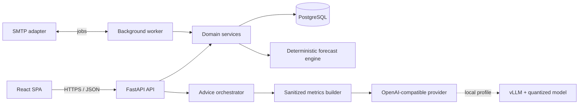

# Архитектура

## 1. Принципы

1. **Сначала финансовая корректность.** Источник истины — неизменяемые проводки и версионированные правила, а не вычисленный баланс в UI.
2. **LLM — интерпретатор, не калькулятор.** Она получает готовые метрики, не имеет инструментов записи и может быть полностью отключена.
3. **Local-first без тупика.** Один и тот же backend работает с локальным vLLM и внешним OpenAI-compatible провайдером через адаптер.
4. **Модульный монолит до доказанной необходимости.** Один backend и одна БД проще развернуть и сохраняют транзакционность. Worker использует те же доменные сервисы.
5. **Прогноз отделён от факта.** Фактический ledger не меняется от сценариев; forecast строится как воспроизводимая функция входного снимка и допущений.

## 2. Контекстная схема



## 3. Репозиторий

```text
apps/
  api/              FastAPI composition root and HTTP contracts
  worker/           schedules, email and durable jobs
  web/              React application
packages/
  backend/domain/   entities, value objects, services, policies
  backend/app/      use cases and ports
  backend/infra/    SQLAlchemy, providers, SMTP and settings
  frontend/api/     generated client and shared contracts
tests/
  e2e/              Playwright user journeys
  contract/         OpenAPI and provider contract tests
infra/
  docker/           images and entrypoints
docs/
```

Poetry управляет Python workspace/package set; pnpm workspace управляет frontend. vLLM остаётся отдельным готовым контейнером и не входит в Python-окружение backend.

## 4. Доменные модули

### Identity & Access

Пользователь, профиль, разрешённый email, приглашение, email verification, credential, refresh session, master bootstrap. API всегда получает `actor_id`; доступ к объекту проверяется на уровне use case/repository, а не только маршрута.

### Ledger

`Account`, `Transaction`, `Posting`, `Category`, `CategoryGroup`, `Tag`. Каждая проведённая транзакция сбалансирована. Доход и расход можно представить второй системной стороной (`income:*`, `expense:*`), перевод — двумя пользовательскими счетами. Баланс вычисляется из posting; проекция/кэш допускается только как перестраиваемая оптимизация.

Поля суммы используют `Decimal` и PostgreSQL `NUMERIC(38, 9)`; валюта хранится ISO
4217-кодом. Допустимая точность posting ограничивается minor units валюты, а округление всегда
вызывается с явной policy. Межвалютный перевод требует явных сумм обеих сторон и
зафиксированного курса, а не скрытого пересчёта. ER-схема и инварианты описаны в
[`DATA_MODEL.md`](DATA_MODEL.md).

### Recurrence

`RecurringRule` создаёт экземпляры через worker. Уникальность `(rule_id, occurrence_at)` и idempotency key делают повторный запуск безопасным. Расписание вычисляется в часовом поясе пользователя, сохранённый instant — UTC. Изменение правила не переписывает уже созданные операции.

### Deposits

Вклад — специализированный счёт плюс `DepositTerms` и денежные потоки. Interest engine — чистая функция календаря, principal history, ставки, day-count convention, капитализации и округления. Плановое начисление и фактическая банковская операция различаются.

### Analytics & Forecast

Analytics читает posting и выдаёт агрегаты. Forecast получает неизменяемый `ForecastInputSnapshot`, создаёт помесячную временную шкалу и возвращает `ForecastResult` с assumptions/version. Никаких записей в фактический ledger.

Для нерегулярных трат MVP использует прозрачную статистику (например, медиана или winsorized mean последних полных месяцев), а не скрытую ML-модель. Диапазон строится из наблюдаемой вариативности. Алгоритм и версия сохраняются с результатом.

В этапе 08 выбран `monthly-cashflow-v1`: account-level медиана максимум шести полных месяцев,
наблюдаемый min/max как sensitivity range и отдельный расчёт каждой валюты. Scenario/goal
records owner-scoped и аудируются, но не являются ledger facts. Несколько целей обслуживает
`priority-waterfall-v1`, поэтому allocation проверяется помесячно без solver/LLM. Полные
формулы — в [`FORECASTS_AND_GOALS.md`](FORECASTS_AND_GOALS.md).

### Goals

Goal engine использует forecast/scenario и решает обратную задачу: требуемый регулярный взнос, достижимая дата либо величина дефицита. Распределение свободного потока по нескольким целям — явная стратегия с приоритетами.

### Advice

Advice orchestrator получает `AdviceContext`: агрегаты, цели, результат сценария и ограниченный список фактов. PII и сырые комментарии не отправляются внешнему провайдеру по умолчанию. Ответ валидируется Pydantic-схемой; некорректный ответ не показывается как достоверный.

## 5. Минимальная модель данных

| Область | Основные таблицы |
|---|---|
| Identity | `users`, `credentials`, `sessions`, `email_allowlist`, `invitations`, `email_tokens` |
| Profile | `profiles`, `user_preferences` |
| Finance | `accounts`, `transactions`, `postings`, `categories`, `category_groups`, `tags`, `transaction_tags` |
| Scheduling | `recurring_rules`, `recurring_occurrences`, `jobs` |
| Deposits | `deposit_terms`, `deposit_rate_periods`; plan вычисляется, fact хранится в linked ledger transactions |
| Planning | `forecast_scenarios`, `forecast_runs`, `goals`, `goal_allocations` |
| AI | `advice_requests`, `advice_results`, `llm_consents` |
| Control | `audit_events`, `idempotency_keys`, `outbox_events`, `schema_metadata` |

Все пользовательские агрегаты имеют `owner_id`. Для финансовых таблиц — timestamps, версия optimistic locking и причинная ссылка на actor/request. На публичном сервере дополнительно рассматривается PostgreSQL RLS как defense in depth, но код всё равно обязан фильтровать владельца.

## 6. API

- REST JSON под `/api/v1`; OpenAPI генерируется FastAPI и считается контрактом.
- Ошибки имеют единый problem-details-подобный формат с машинным `code`.
- POST-команды, которые могут повториться, принимают `Idempotency-Key`.
- Пагинация cursor-based для операций и аудита.
- Frontend-клиент генерируется из зафиксированного `openapi.json`; drift проверяется CI.
- `/health/live` проверяет процесс; `/health/ready` — обязательные зависимости; LLM имеет отдельный необязательный health-status.

## 7. Аутентификация

- Пароли хэшируются Argon2id с параметрами в encoded hash и opportunistic rehash при login.
- Короткий opaque access и ротируемый opaque refresh содержат 256-bit secret; в PostgreSQL
  сохраняются только HMAC-SHA-256 digests. Refresh rotation атомарна, replay отзывает session.
- Access/refresh передаются в `HttpOnly; Secure; SameSite=Strict` cookies. CSRF использует
  отдельный double-submit secret, server-side binding и `X-CSRF-Token` для всех
  cookie-authenticated мутаций.
- CORS разрешает credentials только явным origins; wildcard не принимается даже в development.
- Токены email одноразовые, хэшированные, имеют TTL и subject/purpose binding.
- Первый мастер создаётся под PostgreSQL advisory lock; partial unique constraint навсегда
  закрывает повторный bootstrap после commit.
- Allowlist проверяется при создании приглашения и атомарном consumption токена.
- Login/refresh проходят через application `RateLimiter`; локальный adapter — sliding window
  в памяти одного API process. Server adapter перед горизонтальным масштабированием обязан
  делить состояние между replicas.

## 8. Фоновые задания

Для MVP worker забирает задания из PostgreSQL через `FOR UPDATE SKIP LOCKED`. Scheduler тем
же способом блокирует due rules, атомарно пишет snapshot occurrence в `outbox_jobs` и двигает
`next_occurrence_at`. Jobs имеют attempts, exponential backoff, lease, уникальный
deduplication key и dead-letter state. Ledger commit и acknowledgement jobs разделены;
повтор после crash безопасен благодаря общей application-команде и idempotency key
`(rule_id, occurrence_at)`.

Календарь остаётся чистой доменной логикой: daily/weekly/monthly/yearly, inclusive end date,
`last_day`/`skip`, IANA timezone и явная DST policy. API preview использует тот же калькулятор
без записи в БД. Оператор видит tenant-scoped dead-letter и запускает только аудируемый retry.
Если нагрузка докажет необходимость, порт очереди можно переключить на другой broker без
изменения домена или ledger use case.

## 9. LLM-провайдер

Порт приложения не зависит от SDK:

```text
AdviceProvider.generate(request: AdvicePrompt, response_schema: type[T]) -> T
```

Адаптер использует OpenAI-compatible `/v1/chat/completions` как минимальный общий знаменатель; поддержка `/v1/responses` может добавляться capability negotiation. Настройки: `base_url`, `api_key`, `model`, timeout, retry budget, max tokens, privacy mode. API key локального vLLM может быть фиктивным, но интерфейс одинаков.

Стартовый кандидат для 6 ГБ: официальный `Qwen/Qwen3-4B-AWQ`, 4-bit, с выключенным thinking для обычных советов, `max_model_len` сначала 2048–4096, `max_num_seqs=1`, ограничением GPU memory utilization. Это кандидат для измерения, не обещание совместимости: после загрузки модели обязателен smoke-test и измерение VRAM; при OOM — уменьшение контекста или модель 1.7B/0.6B, а не выгрузка части финансовой логики в LLM.

## 10. Compose-профили

- По умолчанию/core: `postgres`, `api`, `worker`, `web`.
- `mail`: плюс локальный SMTP-catcher.
- `local-llm`: плюс `vllm` с GPU reservation и постоянным Hugging Face cache.
- Backend зависит от PostgreSQL, но не зависит по health condition от vLLM.

Все образы и зависимости пинятся; `latest` не допускается в воспроизводимом релизе. Для Windows документируется Docker Desktop с WSL2 backend и GPU passthrough.

## 11. Проверочная стратегия

- Unit: money/rates, ledger invariants, recurrence calendars, deposit examples, forecast, goals.
- Property-based: сумма posting равна нулю, reversal сохраняет историю, повтор occurrence идемпотентен, monotonic goal cases.
- Integration: PostgreSQL repositories, migrations up/down where safe, job claiming, auth sessions.
- Contract: OpenAPI snapshot, generated client, fake OpenAI-compatible server, structured advice parsing.
- E2E: семь сценариев из `SPEC.md`.
- Security: cross-tenant matrix, token replay/expiry, CSRF/CORS, rate limits, log redaction.
- Operations: compose health, backup/restore drill, migration on copy of data, LLM-off mode.

