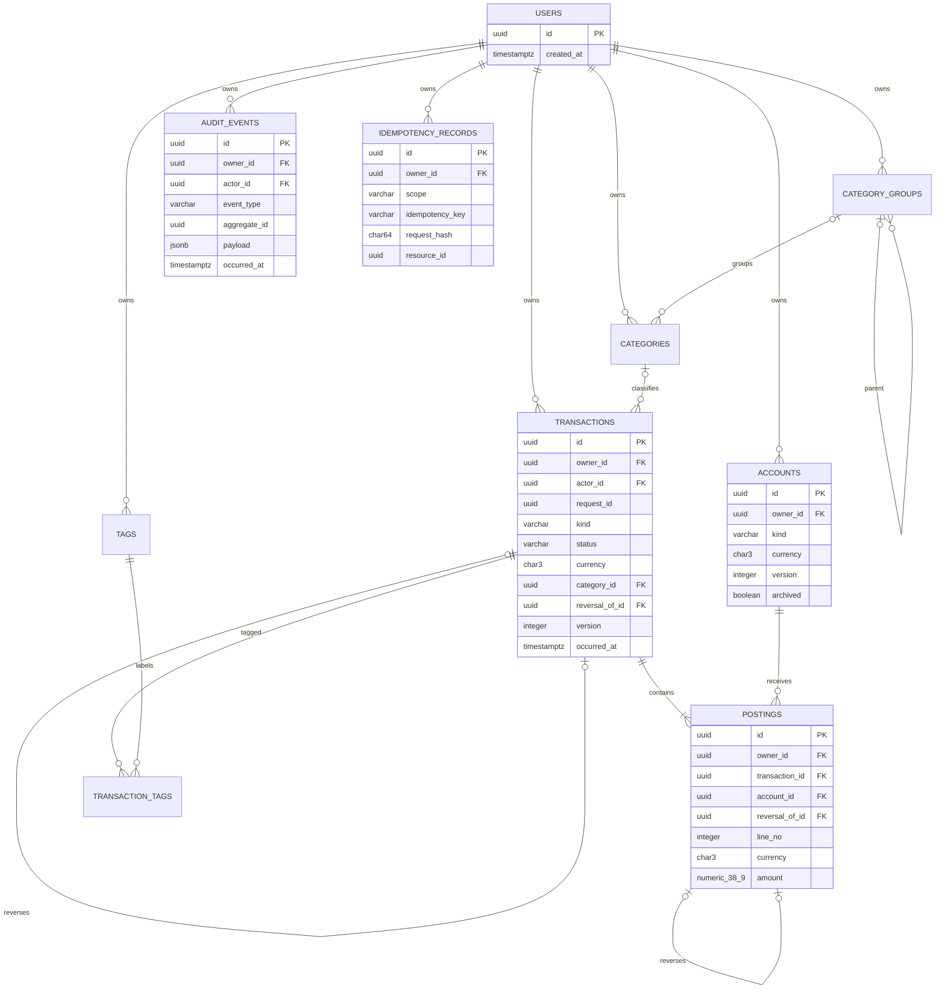

# Модель финансовых данных

Этап 02 реализует double-entry ledger как единственный источник фактических остатков.
Проведённая операция неизменяема; исправление — новая reversal transaction с причинными
ссылками. В таблицах нет доверенного «UI balance»: любой остаток перестраивается суммой
`postings.amount`.

## ER diagram

`users` — только Identity shell. Credential/session/profile появляются не раньше этапа 03.
Finance включает `accounts`, `category_groups`, `categories`, `tags`, `transactions`,
`postings`, `transaction_tags`. Control включает append-only `audit_events`, append-only
`idempotency_records` и глобальную `schema_metadata`.

## Точность и время

- Сумма posting хранится в `NUMERIC(38, 9)`. Это storage capacity, а не разрешение молча
  записывать девять знаков для любой валюты.
- `Money` допускает minor units валюты: обычно 2, 0 для JPY-подобных и 3 для
  KWD-подобных кодов. Неизвестный трёхбуквенный код получает 2 знака до появления отдельного
  справочника валют.
- `Rate` имеет максимум 12 дробных знаков и пока не персистится отдельной таблицей.
- Входные `float`, `NaN` и infinity запрещены. Округление выполняется только через явно
  выбранную `HALF_EVEN` или `HALF_UP` policy.
- Все instants обязаны иметь timezone и нормализуются в UTC; PostgreSQL использует
  `TIMESTAMPTZ`. `DateRange` — полуоткрытый интервал `[start, end)`.

## Ledger invariants

1. Transaction имеет минимум две ненулевые posting одного currency; их сумма равна нулю.
2. `owner_id` и currency transaction/account/posting согласованы составными FK.
3. Внешний код работает только с `posted`; `pending` — внутритранзакционное состояние адаптера.
   Deferred triggers не позволяют закоммитить pending или несбалансированную transaction.
4. После `posted` transaction и её postings нельзя обновить или удалить.
5. Reversal имеет уникальную ссылку на исходную transaction. Каждая её posting уникально
   ссылается на соответствующую исходную posting и обязана иметь тот же account/currency и
   строго противоположную сумму.
6. Income/expense требуют category правильного kind. Transfer и reversal не имеют category.
7. Межвалютный transfer текущей фабрикой запрещён. Будущая модель FX обязана хранить обе
   явные суммы и курс; скрытого пересчёта нет.
8. Mutable справочники и accounts используют optimistic `version`; stale update отклоняется.
9. Audit и idempotency rows append-only. Ключ идемпотентности уникален в
   `(owner_id, scope, idempotency_key)` и связан с SHA-256-shaped request hash.

## Знак и примеры проводок

Положительная posting увеличивает баланс account, отрицательная уменьшает. System-side
accounts принадлежат тому же owner и имеют kind `system_income`/`system_expense`.

| Операция | Account | Posting |
|---|---|---:|
| Доход 1000 RUB | `bank` | `+1000.00` |
|  | `system_income` | `-1000.00` |
| Расход 125.25 RUB | `bank` | `-125.25` |
|  | `system_expense` | `+125.25` |
| Перевод 200 RUB | `bank` | `-200.00` |
|  | `cash` | `+200.00` |
| Reversal расхода | `bank` | `+125.25`, ссылка на исходную posting |
|  | `system_expense` | `-125.25`, ссылка на исходную posting |

После дохода, расхода, перевода и reversal расхода: `bank = 800.00`, `cash = 200.00`,
`system_income = -1000.00`, `system_expense = 0.00`. Результат получается только из postings.

## Owner scope и индексы

`PostgresLedgerRepository(session, owner_id)` нельзя создать без владельца; методы чтения не
принимают optional owner и всегда добавляют scope. Основные access paths покрыты индексами:
transactions `(owner_id, occurred_at, id)`, postings `(owner_id, account_id)` и
`(owner_id, transaction_id)`, audit `(owner_id, occurred_at)`.

PostgreSQL RLS остаётся будущей defense-in-depth мерой. Текущая защита состоит из repository
scope, составных owner FK и integration tests с двумя владельцами.

## Миграции и downgrade

`20261013_0002` применяется на чистую БД и проверяется `alembic check`. Downgrade до
`20261013_0001` удаляет финансовую схему и поэтому тестируется только на пустой disposable
database. Для БД с реальными данными такой downgrade разрушителен и не является рабочей
процедурой отката; используется forward fix/backup restore.
