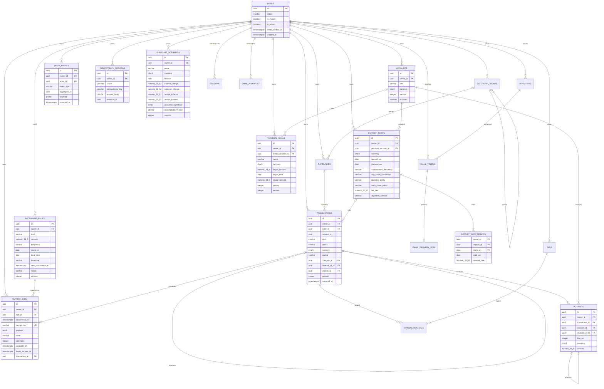

# Модель данных

Этапы 02–13 реализуют double-entry ledger как единственный источник фактических остатков.
Проведённая операция неизменяема; исправление — новая reversal transaction с причинными
ссылками. В таблицах нет доверенного «UI balance»: любой остаток перестраивается суммой
`postings.amount`.

## ER diagram

Этап 03 расширяет `users` состоянием `active/disabled` и единственным `is_master`, а также
добавляет `user_profiles`, `credentials`, `sessions`, `email_allowlist`, `invitations` и
`email_tokens`. Email нормализуется до lowercase; password hash — Argon2id encoded string.
Session и email token содержат только 64-символьные HMAC-SHA-256 digests, никогда raw secret.
Refresh и email-token consumption выполняются под row lock; TTL, revoke и consumed state
проверяются в той же транзакции, что и mutation/audit.

Finance включает `accounts`, `category_groups`, `categories`, `tags`, `transactions`,
`postings`, `transaction_tags`. Control включает append-only `audit_events`, append-only
`idempotency_records`, `recurring_rules`, durable `outbox_jobs` и глобальную
`schema_metadata`.

`categories.is_mandatory` — явный boolean для обязательной доли расходов; DB constraint
разрешает его только для expense category. Analytics не хранит totals: owner-scoped read model
вычисляется из posted transactions/postings и возвращает исходные UUID как evidence.

Deposits включает versioned `deposit_terms` (name, archived, automatic_interest, updated_at)
и `deposit_rate_periods`. Изменение сохраняет полный before/after snapshot в append-only audit.
Производный план не дублируется в таблице: он строится из условий и всех principal postings,
кроме процентов и отменённых операций. Внутренний account создаётся вместе с вкладом и скрыт
из списка обычных счетов. Проценты — immutable ledger transaction kind `interest`;
`deposit_id` также переносится в reversal. Worker проводит только разность due и posted.

Planning включает `forecast_scenarios` и `financial_goals`. Оба набора строк owner-scoped,
имеют optimistic `version`, а create/update сопровождаются append-only `audit_events`.
Scenario one-time account links хранятся в JSON snapshot assumptions и проверяются application
service перед записью; goal linked account дополнительно защищён составным owner/account/
currency FK. `ForecastInputSnapshot`, timeline и results в БД не сохраняются и не являются
финансовыми фактами.

## Точность и время

- Сумма posting хранится в `NUMERIC(38, 9)`. Это storage capacity, а не разрешение молча
  записывать девять знаков для любой валюты.
- `Money` допускает minor units валюты: обычно 2, 0 для JPY-подобных и 3 для
  KWD-подобных кодов. Неизвестный трёхбуквенный код получает 2 знака до появления отдельного
  справочника валют.
- `Rate` имеет максимум 12 дробных знаков; deposit rates хранятся как `NUMERIC(20, 12)`.
- Входные `float`, `NaN` и infinity запрещены. Округление выполняется только через явно
  выбранную `HALF_EVEN` или `HALF_UP` policy.
- Все instants обязаны иметь timezone и нормализуются в UTC; PostgreSQL использует
  `TIMESTAMPTZ`. `DateRange` — полуоткрытый интервал `[start, end)`.

## Ledger invariants

1. Transaction имеет минимум две ненулевые posting одного currency; их сумма равна нулю.
2. `owner_id` и currency transaction/account/posting согласованы составными FK.
3. Внешний код работает только с `posted`; `pending` — внутритранзакционное состояние адаптера.
   Deferred triggers не позволяют закоммитить pending или несбалансированную transaction.
4. После `posted` transaction и её postings нельзя обновить или удалить.
5. Reversal имеет уникальную ссылку на исходную transaction. Каждая её posting уникально
   ссылается на соответствующую исходную posting и обязана иметь тот же account/currency и
   строго противоположную сумму.
6. Income/expense требуют category правильного kind. Transfer, interest и reversal не имеют
   category. Adjustment также не имеет category и балансируется через скрытый `system_equity`
   account. Interest требует `deposit_id` и балансируется через `system_income`.
7. Межвалютный transfer текущей фабрикой запрещён. Будущая модель FX обязана хранить обе
   явные суммы и курс; скрытого пересчёта нет.
8. Mutable справочники и accounts используют optimistic `version`; stale update отклоняется.
9. Audit и idempotency rows append-only. Ключ идемпотентности уникален в
   `(owner_id, scope, idempotency_key)` и связан с SHA-256-shaped request hash.

## Scheduling invariants

1. Rule принадлежит одному owner; account/category/destination защищены составными owner FK.
2. Wall-clock anchor хранится отдельно от `next_occurrence_at`: календарь считается в IANA
   timezone, а occurrence персистится как UTC `TIMESTAMPTZ`.
3. `(rule_id, occurrence_at)` кодируется в уникальный `outbox_jobs.dedup_key`. Job хранит
   immutable snapshot operation, поэтому последующее редактирование rule не меняет доставку.
4. Scheduler и worker выбирают строки через `FOR UPDATE SKIP LOCKED`; claim устанавливает
   lease owner/expiry и увеличивает attempts.
5. States: `pending → leased → succeeded`; ошибка возвращает `pending` с exponential backoff
   или переводит в `dead_letter`. `succeeded` обязан ссылаться на ledger transaction.
6. Ledger idempotency key совпадает с outbox dedup key. Crash после transaction commit до
   job acknowledgement приводит к replay той же transaction, а не к новой проводке.

## Identity and email invariants

1. `email_allowlist` uses soft revoke. Revocation may disable a matching non-master `users` row
   and revoke sessions/tokens, but no user-owned financial row is deleted or reassigned.
2. `email_tokens` stores only a keyed digest and exactly one user/invitation subject. Consumption
   is atomic under row lock; consumed, expired or revoked tokens cannot be replayed.
3. `email_delivery_jobs` is a separate leased outbox. It references one token, retries at most
   five times, and clears `text_body` after successful SMTP delivery.
4. Master/admin authorization is checked in the application service. Only master can set an
   invited user's `is_admin`; the partial unique index still permits exactly one master.
5. Invitation acceptance checks active allowlist, unused invitation/token, expiry and unique
   normalized credential in one transaction before creating the tenant root.

## Deposit invariants

1. Deposit и principal account имеют одного owner/currency; principal account имеет kind
   `deposit`. Все repository reads owner-scoped.
2. Terms имеют optimistic version и before/after audit; удаления строк нет.
   Rate periods — непересекающиеся полуоткрытые интервалы,
   без пробелов покрывающие `[opened_on, matures_on)`.
3. Cashflow берётся из любого principal posting обычной операции, включая начальный adjustment
   и переводы без `deposit_id`. Отменённые пары исключаются из исправленного плана.
   Interest posting не становится входным cashflow и поэтому не удваивает капитализацию.
4. Фактический interest и его reversal остаются immutable ledger rows и audit events.
5. Полные формулы, cut-off, day-count, rounding, tax, early-close и XIRR описаны в
   [DEPOSIT_CALCULATIONS.md](DEPOSIT_CALCULATIONS.md).
6. Миграция legacy-контрактов не меняет ledger: automatic_interest=false до проверки владельцем.
   Включение автоматического режима запрещено для нескольких активных договоров одного account.

## Forecast and goal invariants

1. Scenario и goal доступны только через обязательный owner scope; linked account и one-time
   cashflow account обязаны принадлежать owner и совпадать по currency.
2. Scenario/goal mutation пишет audit event, но никогда не создаёт transaction/posting.
3. Forecast result вычисляется из immutable snapshot; `snapshot_id` зависит от всех input
   facts, `captured_at` и currency, но не от порядка чтения строк.
4. Forecast currencies не объединяются; FX отсутствует.
5. Goal allocation сортирует `(priority, target_date, UUID)` и не использует optimizer/LLM.
6. Полные формулы и ограничения описаны в
   [FORECASTS_AND_GOALS.md](FORECASTS_AND_GOALS.md).

## Знак и примеры проводок

Положительная posting увеличивает баланс account, отрицательная уменьшает. System-side
accounts принадлежат тому же owner и имеют kind `system_income`/`system_expense`.

| Операция | Account | Posting |
|---|---|---:|
| Доход 1000 RUB | `bank` | `+1000.00` |
|  | `system_income` | `-1000.00` |
| Расход 125.25 RUB | `bank` | `-125.25` |
|  | `system_expense` | `+125.25` |
| Перевод 200 RUB | `bank` | `-200.00` |
|  | `cash` | `+200.00` |
| Reversal расхода | `bank` | `+125.25`, ссылка на исходную posting |
|  | `system_expense` | `-125.25`, ссылка на исходную posting |
| Факт процентов вклада 3 USD | `deposit` | `+3.00`, `deposit_id` |
|  | `system_income` | `-3.00`, `deposit_id` transaction |

После дохода, расхода, перевода и reversal расхода: `bank = 800.00`, `cash = 200.00`,
`system_income = -1000.00`, `system_expense = 0.00`. Результат получается только из postings.

Начальный остаток и ручная сверка записываются transaction kind `adjustment`: signed amount
попадает в asset account, строго противоположная сумма — в owner/currency-scoped
`system_equity`. `transactions.source` различает `manual`, `import` и внутренний `system`, а
tags связываются через `transaction_tags`; ни одно из этих полей не участвует в арифметике.

## Owner scope и индексы

`PostgresLedgerRepository(session, owner_id)` нельзя создать без владельца; методы чтения не
принимают optional owner и всегда добавляют scope. Основные access paths покрыты индексами:
transactions `(owner_id, occurred_at, id)`, postings `(owner_id, account_id)` и
`(owner_id, transaction_id)`, audit `(owner_id, occurred_at)`.

PostgreSQL RLS остаётся будущей defense-in-depth мерой. Текущая защита состоит из repository
scope, составных owner FK и integration tests с двумя владельцами.

## Миграции и downgrade

`20261016_0011` применяется на чистую БД и проверяется `alembic check`. Downgrade до
`20261013_0001` удаляет финансовую схему и поэтому тестируется только на пустой disposable
database. Для БД с реальными данными такой downgrade разрушителен и не является рабочей
процедурой отката; используется forward fix/backup restore.
